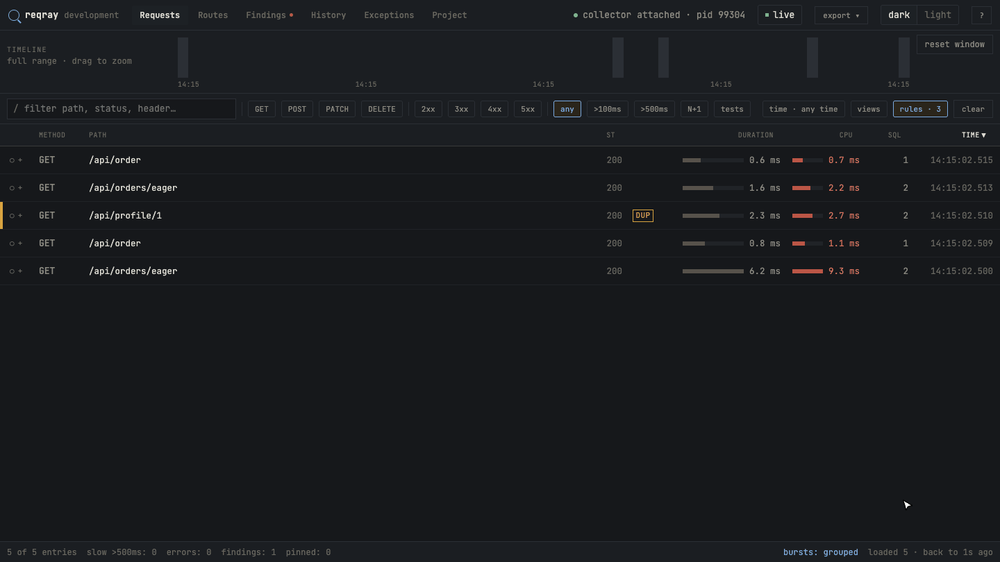
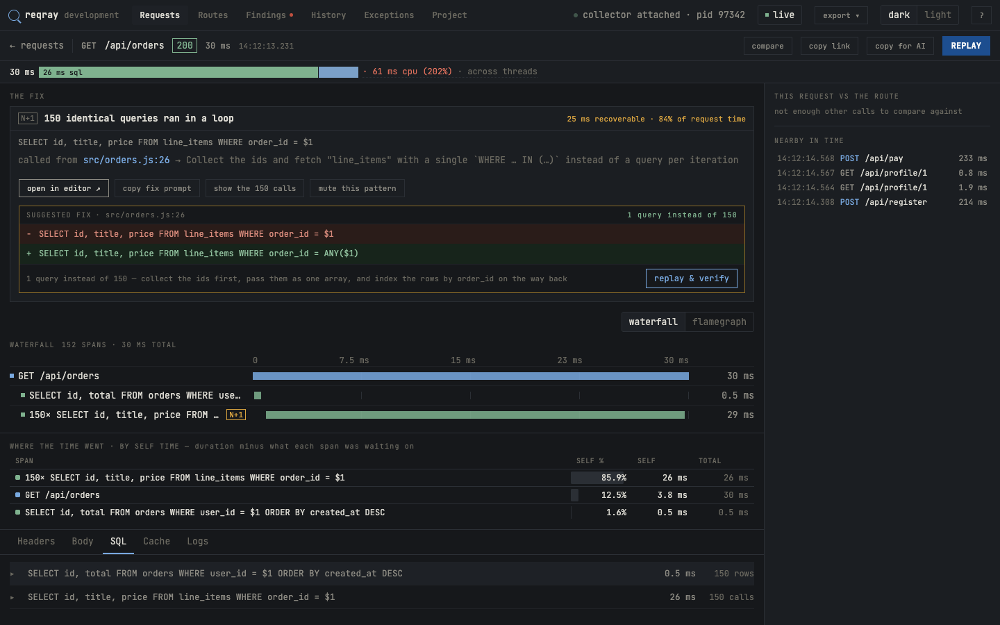
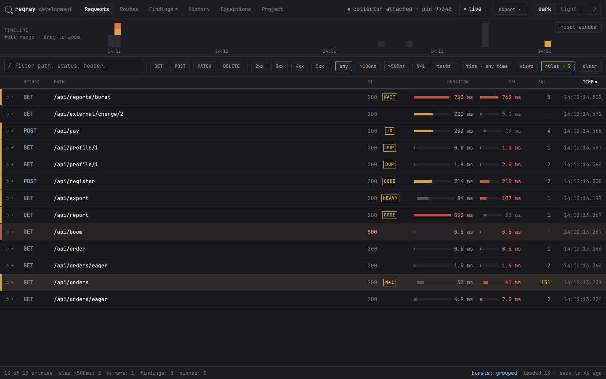

# Reqray

A dev panel and request-inspection tool for Node.js. Plugs in with a single
line, instruments HTTP and SQL on its own, shows every request as a waterfall,
and finds N+1 **down to the file, the line, and the time saved**.



Think Laravel Telescope for the Node ecosystem, with two differences: the
instrumentation is fully automatic — no `recordQuery` calls in your code — and
the core is designed for production, not just localhost.

> You see one specific slow request whole — SQL, bodies, outgoing calls, the
> log — and you know at once which line of code is slowing it down.

We don't compete with Datadog or New Relic on aggregates and charts. Reqray is
about the post-mortem of a single request and about finding N+1 — inside your
own process, with no account and nothing sent anywhere, down to the line of
code and the milliseconds it costs. Hosted tools can flag an N+1 from the
traces you ship them; this one shows it on your machine before you ship
anything.

## What it looks like

```
150 identical queries ran in a loop
  src/orders.js:26
  ~29 ms recoverable out of the 48 ms request
  → Collect the ids and fetch "line_items" with a single
    WHERE … IN (…) instead of a query per iteration
```

Not "this request made 151 database calls" but "here is the line, here is how
much time comes back, here is what to do".



On the left, the waterfall: a run of 150 identical queries folded into a
single bar. Below it, a callout with the finding's cost and the line of code;
below that, the SQL, with the repeats collected into one row marked `150 calls`.



Try it with a single command. Via Docker, with a real Postgres and Redis in
neighboring containers:

```bash
docker compose up --build
# open http://localhost:3100/_reqray/ — and that is the whole instruction
```

Or with no Docker at all — the database and the cache come up embedded:

```bash
pnpm build && pnpm --filter @reqray/example-fastify-postgres start
# open http://127.0.0.1:3000/_reqray/
```

**The demo calls its own routes.** There is nothing to curl: it walks a plan
on a loop — an N+1 and the same query done right, sequential and parallel
external calls, a masked login and checkout, a cached profile read one time
too many, a slow report over its budget, a pair of flaky requests to compare
and an exception to group — so the panel is already full when you open it, and
keeps moving while you read. `DEMO_TRAFFIC=off` stops it;
`pnpm --filter @reqray/example-fastify-postgres traffic` sends a burst by hand.

The screenshots above come from this very demo: a UI test takes them in a
real browser, and the same test checks that the panel rendered at all.

## Getting started

**Zero lines of code** — adding `--import` to the launch is enough:

```bash
pnpm add -D @reqray/register
node --import @reqray/register app.js
```

If the application has no Reqray adapter, register intercepts incoming HTTP on
its own through Node's standard `diagnostics_channel` and brings the panel up
on a neighboring port:

```
reqray: no adapter found — panel is up at http://127.0.0.1:4310/_reqray/
```

This is the "try it in 30 seconds" mode: SQL, outgoing calls, the waterfall
and the detectors already work. The limitations are honest — request bodies
are not collected (reading someone else's stream is off limits), Replay is
unavailable, paths come without route normalization. The port is
`REQRAY_PANEL_PORT`; turn it off with `REQRAY_STANDALONE=off`.

**Full recording** — an adapter in one line:

```bash
pnpm add @reqray/fastify @reqray/register
```

```js
import Fastify from 'fastify';
import { reqray } from '@reqray/fastify';

const app = Fastify();
await app.register(reqray);
```

```bash
node --import @reqray/register app.js
```

`--import` is mandatory: the loader hooks must be in place before the
application loads its database driver. Launch without it and Reqray will say so
at startup rather than stay silent:

```
reqray  instrumentation active
  ✔ fastify@5.12.0       requests
  ✔ pg@8.23.0            SQL
  ✔ ioredis@5.11.1       cache
  ✔ undici (built-in)    outgoing HTTP
```

Express takes two handlers — Express hands exceptions only to the error
handler, and it has to go after the routes:

```js
const inspector = reqray();
app.use(inspector.middleware);
// ...routes...
app.use(inspector.errorHandler);
```

For NestJS — a module in `imports`; the platform (Express or Fastify) is
detected on its own:

```ts
import { ReqrayModule } from '@reqray/nestjs';

@Module({
  imports: [ReqrayModule.forRoot()],
})
export class AppModule {}
```

## Staging: agent and collector

Locally the data lives in process memory. Wherever the process is reachable
from outside, the application only collects and ships batches, while storage
and the panel live in a separate process — `@reqray/server`:

```js
import { httpTransport } from '@reqray/transport-http';

await app.register(reqray, {
  enabled: true,
  mode: 'production',
  panel: false, // the panel lives on the collector
  transport: httpTransport({
    url: 'http://reqray-collector:4300',
    token: process.env.REQRAY_TOKEN,
  }),
});
```

```bash
npx @reqray/server            # REQRAY_TOKEN=… HOST=0.0.0.0 — to listen externally
```

The transport never blocks the application: the queue is bounded, on overflow
the **oldest** entries are dropped, and an unreachable collector is a log
warning plus exponential-backoff retries, not growing memory. Without a token
the collector listens only on 127.0.0.1; with a token, panel sign-in is
`/auth?token=…`.

The fully assembled stack is in `docker-compose.staging.yml`:

```bash
docker compose -f docker-compose.staging.yml up --build
# application: http://localhost:3100/api/orders
# panel:       http://localhost:4300/auth?token=staging-secret
```

## What's already there

| | |
|---|---|
| Frameworks | Fastify 5, Express 4/5, NestJS 10/11 (both platforms), any `node:http` — in standalone mode |
| Database | `pg` (and Prisma 7 — it goes through node-postgres) |
| Cache | `ioredis` 5 and 6, standalone and cluster, pipelines included — the command, the key, hit or miss. Values are never recorded |
| Outgoing HTTP | undici and the built-in `fetch`, via `diagnostics_channel`; the calling line of code — via the `fetch` wrapper |
| Detectors | N+1; sequential HTTP calls (a missed `Promise.all`); the same outbound read made twice; the same cache key read twice; a response too large for what it carries; a query queueing for a connection; a transaction held open across a call; a stretch of the request spent in your own code; a request over its time budget |
| Panel | list with a timeline scrubber, filters, highlight rules and a live feed; waterfall or flamegraph; findings; SQL with EXPLAIN; bodies, headers, logs; request replay; per-route aggregates; two-request comparison; exception groups with git blame; a Project tab with the startup report and the settings in force |
| Time | drag across the strip, or pick a stretch in the `time` pill — last 15 min, today, yesterday, or exact minutes. The store applies it, so narrowing searches the history rather than the page on screen |
| Keyboard | `j`/`k` to move, `↵` to open, `/` to filter, `space` to pause, `p` to pin, `c` to compare, `?` for the list |
| Export | HAR and a curl script (built by the collector, masking intact), trace JSON, a deep link |
| Logs | `console.*` calls made during handling land in their request's record; terminal output is unchanged. pino/winston write past console and are not captured yet |
| Terminal | `@reqray/cli`: the live stream (`reqray watch`) and one request in full (`reqray show`), over the same API the panel uses |
| Transport | in-memory locally; HTTP batches with backpressure to `@reqray/server` |
| Storage | a ring in memory by default; `@reqray/store-sqlite` for a history that outlives the process, with retention by count, by disk and by age. Both page by cursor and filter on the server |
| Logs on disk | `@reqray/transport-file`: every recorded request as a line of JSON, a file per day, swept by the same retention policy the store obeys |
| Retention | one policy for everything that keeps anything — days, size, count — shown on the Project tab and changeable there, remembered on disk so it survives a restart |

**EXPLAIN — one click on a SQL span.** The query plan with hints right in the
detail view: a Seq Scan with a filter is flagged with "An index on the
filtered column may help". The SQL comes from the record — the panel client
cannot send its own; `ANALYZE` is never used, so nothing ever executes;
parameterized queries are planned via `GENERIC_PLAN` (PostgreSQL 16+);
EXPLAIN goes to the same pool that ran the original query. Outside local
development it is opt-in only: `reqray({ explain: true })`.

**The Project tab answers "why do I not see my SQL".** The startup report —
what was instrumented, what was not, and what to do about it — used to exist
only as a line printed once at boot, which in a container nobody ever sees. It
is a screen now, next to the settings actually in force: the sampling share,
the storage and how full it is, which of replay, EXPLAIN, blame and SQL values
are on, and the exact list of fields masked before anything is written. Plus
the application's name, version and the commit it is running, which is the
first question asked of a staging panel. Nothing secret is on it: environment
variables are never read, and the panel's gate is reported as present, never
by value.

**A history, when you want one.** By default requests live in a ring in
memory: the last 500, gone when the process restarts. That is the right
default for a dev panel and the wrong one for "what happened an hour ago", so
storage is a transport:

```js
import { sqliteTransport } from '@reqray/store-sqlite';

await app.register(reqray, {
  transport: sqliteTransport({ file: '.reqray/requests.db' }),
});
```

Requests then outlive the process, the list pages by cursor instead of
arriving all at once, and the filter goes to the store — so "only the errors"
means every error there is, not every error on screen. Retention holds two
budgets, whichever runs out first: `maxRequests` (20 000) and `maxBytes`
(256 MB). Pinned requests are exempt from both. Needs Node 22.5 or newer,
where SQLite is built in; nothing is compiled at install time.

The collector takes the same store — `REQRAY_DB=/var/lib/reqray/requests.db`
— which is what makes a staging stand answer questions about yesterday.

**A log beside the store.** A database is what the panel reads; it is not what
`grep` reads, what `tail -f` follows, or what a log shipper picks up. So the
same requests can also be written as one line of JSON each, a file per day:

```js
const retention = retentionPolicy({ days: 7, file: '.reqray/retention.json' });

await app.register(reqray, {
  retention,
  transport: [
    sqliteTransport({ file: '.reqray/requests.db', retention }),
    fileTransport({ dir: '.reqray/log', retention }),
  ],
});
```

On the collector it is two variables: `REQRAY_LOG=/var/lib/reqray/log` and
`REQRAY_DAYS=7`. Writing is streamed and never on the request path; a write
that fails takes the log down and nothing else, and a log that falls behind
the application drops lines and counts them rather than growing the heap.

**One retention setting, and the panel can change it.** `retentionPolicy` is
the one number the store and the log both evict by — days, and optionally a
size and a count. The Project tab shows it and, when the policy is writable,
lets it be changed: the stores sweep on the news rather than at the next
restart, and the new value is remembered in a small JSON file, so it is still
in force after a deploy. Lowering it deletes data, which is why it is the only
setting the panel writes and why a policy can be created `writable: false`.
Requests that arrive already older than the limit are not stored at all — the
collector receives batches late, and writing something only to sweep it a
minute later is work nobody asked for.

**Pinning.** A pinned request survives the ring buffer and ignores every
filter, so the incident you are working on does not scroll away while you read
it. Pinning is capped (50) — it suspends the promise that memory is bounded,
so it gets a bound of its own.

**Routes.** Per-route aggregates over the retained window: calls, rps,
p50/p95/p99, error rate, average SQL and the share of recorded time each route
accounts for. Paths are normalized per segment (`/api/orders/8812` →
`/api/orders/:id`), and a hex token needs a digit to count as an id so that
`/api/feed` stays `/api/feed`.

**Compare.** Two requests side by side: a metrics table where the delta says
whether the change is an improvement, both waterfalls on one scale, the work
paired shape by shape, and a verdict in words — which is faster, by how much,
whether the N+1 disappeared and what to look at next.

**Test provenance.** A test harness that sets `x-reqray-test` on its requests
gets them marked in the list, filterable by their own chip, and an exception
group then names the test that reproduces it — the one to run again. Header
values are latin1, so a name containing `›` should be percent-encoded; Reqray
decodes it.

**The terminal, when a browser window is one too many.** `@reqray/cli` is a
client for the same API the panel is built on — no instrumentation of its own,
nothing to configure, and a collector reached through an ssh tunnel is just a
URL.

```console
$ npx @reqray/cli watch --slower-than 100
reqray 0.6.0   watching localhost:3000   pid 41822   ctrl-c to stop

   TIME         METHOD ST  PATH                               DUR    Q FLAGS
   09:41:03.077 POST   201 /api/orders                      118ms   9q
!  09:42:10.184 GET    200 /api/orders                      512ms  51q N+1
!! 09:43:02.184 POST   500 /api/orders                      2.14s  12q ERR
   └ TypeError: Cannot read properties of undefined (reading 'currency')
     services/pricing.js:61                            reqray show 9012
```

One line per request on a fixed grid, and severity in the first two columns as
a glyph rather than as a colour — so `NO_COLOR`, a pipe and a CI log lose
nothing. `reqray show <id>` prints the waterfall, the findings with the line of
code and the fix, and the response. The stream prints no identifiers by
default — a dozen characters of noise on every line, where the eye is looking
for the path — so a row on screen is opened by the question that found it:
`--last`, `--last --failed`, `--last --slowest`, `--last --path /orders`, all
answered by the collector rather than by picking through a page of results. Add
`--ids` to the stream when you would rather copy one.

`--sql` prints every query wrapped rather than cut, `--json` hands back the raw
trace, and `--ascii` drops the box-drawing characters for a terminal that
cannot show them. Exit codes are 0, 1 for a failure or a collector that cannot
be reached, and 2 for arguments — so it composes.

## Security

- `enabled` defaults to `NODE_ENV !== 'production'`.
- Sensitive fields are masked **before** they reach the buffer, not at
  display time. By default `authorization`, `cookie`, `set-cookie` are covered
  in headers and `password`, `token`, `secret`, `cardNumber`, `cvv`, `apiKey`,
  `signature` in bodies and query strings. A name matches when it contains
  one of these, separators aside — `token` covers `access_token`. Headers
  such as `x-api-key` are yours to add: `redact: { headers: ['x-api-key'] }`.
- The panel does not mount without an explicit gate anywhere except local
  development (`NODE_ENV` is `development`, `test`, or unset). In staging the
  application fails at startup with an explanation instead of silently
  opening access.
- A panel with no gate answers only to the machine it runs on: the connection
  has to come from loopback and be addressed to `localhost` or `127.0.0.1`.
  A server deployed without `NODE_ENV` therefore does not publish its
  requests, and a hostile page cannot reach a local panel by re-pointing its
  own domain at 127.0.0.1. Reaching the panel from another machine, or from
  outside a container, takes a gate — `panel: { gate: 'open' }` if open
  access is what you mean.
- Sensitive parameters in query strings are masked like body fields, in the
  request's own URL and in the URLs of outgoing calls: `?token=abc` is
  stored as `?token=[redacted]`.
- Request replay outside local development is forbidden and enabled only by an
  explicit flag: a replay in production is a second card charge and a second
  email.
- `git blame` for exception frames runs `git` on the machine the panel runs
  on, so it follows the same rule: local development by default,
  `reqray({ blame: true })` anywhere else.
- Exports carry the masking with them: a curl script replays a request with
  `[redacted]` where the credential was, and says so in a comment.
- SQL parameter values are not collected in any mode. For local debugging
  there is an explicit opt-in, `collectSqlValues: true` — enable it
  deliberately: positional values carry no field names, so name-based masking
  does not protect them. Values are never interpolated into EXPLAIN.
- Cache values are not collected in any mode, and there is no opt-in. A cache
  span holds the command, the key and the outcome: `SET session:9 <jwt>` is
  recorded as `SET session:9`. Which arguments count as a key is decided per
  command; anything Reqray does not recognise — a custom command, `AUTH` —
  records its name and nothing else.

## Overhead

Reqray executes inside someone else's application, on the hot path, so the
overhead numbers are part of the product, not a formality. The benchmark
lives in `bench/` and runs three scenarios against the real demo application:

```bash
DATABASE_URL=postgresql://... pnpm bench
```

Conditions: Fastify 5 + pg + Postgres 18 as a separate process, Node 24, macOS
arm64 (Apple M5), 1000 rps, 20 connections, 30 s measured after 5 s of warmup. Deltas are
against an application that never loaded Reqray at all — not even the loader
hook. Memory figures are medians of per-second samples under load; "retained"
is the heap after a forced GC. Every scenario was run three times, and the
latency column shows the spread across those runs rather than one lucky
number.

```
                          p99      retained    V8 heap
one SQL query, small response
  enabled: false      −1…+1 ms      +2.8 MB     −13 MB
  prod, 1% sample     +2…+3 ms      +5.9 MB    +116 MB
  development, 100%   +3…+15 ms     +5.0 MB    +126 MB
  staging, batches    +3…+4 ms      +5.0 MB    +116 MB

2 SQL queries, a 150-order response
  enabled: false      −7…+2 ms      +2.9 MB     +4.0 MB
  prod, 1% sample     −6…+1 ms       +14 MB      +57 MB
  development, 100%   −5…+9 ms       +19 MB     +109 MB
  staging, batches    −4…+17 ms      +5.4 MB      +44 MB
```

**Disabled Reqray costs nothing per request** — and that is a property of the
code, not a reading off a noisy graph: with `enabled: false` the adapter
registers no hooks at all, so there is nothing to run and nothing to allocate
when a request arrives. The p99 spread in that row is the same jitter the
baseline itself has.

**The memory in the disabled row is the loader, not Reqray.** The baseline
never runs `--import @reqray/register`, while `enabled: false` does: the module
hooks, `import-in-the-middle` and the instrumentation modules are loaded and
sitting there. That is ~2.8 MB of live heap for keeping the flag flippable
without a redeploy. Drop the `--import` too and the row goes to zero, because
then there is nothing of Reqray in the process.

**Staging here ships 100% of requests** — that is the demo-stand
configuration, so that every click shows up in the collector panel. Shipping
full bodies at ~29 MB/s costs tail latency: up to +17 ms p99 on the typical
scenario, and it is the row that moves most from run to run, because the
collector competes for the same CPU. With the production sample share (1%)
the shipping disappears from the tails. Meanwhile the agent retains less than
any mode with a panel — the transport queue holds already-serialized strings,
not objects.

**On the lightest request, production mode moves the tail by 2–3 ms, and that
is over this project's own target of +0.5 ms.** The request takes 2–3 ms at
p99 without Reqray and 4–5 ms with it, in all three runs — a consistent
reading, not a lucky or unlucky one. The median does not move. Development
mode costs the same or more, with one run of the three at +15 ms. Until it
is brought down, treat +3 ms p99 at this load as the price in production mode
and decide with that number.

**What that tail is made of.** Not work on the request path: a CPU profile
puts Reqray's own code at 2–4 µs per request, and measured directly — one
connection, requests one after another, against the embedded database —
production mode adds about 5 µs to the median request and 40 µs at p99. What is left is
memory. Reqray allocates about 5 KB per request for the scope, the spans and
the wrappers around the driver, which means more young-generation collections,
and at 1000 rps over 20 connections each pause lands on everything in flight
and queues what arrives behind it. `node --max-semi-space-size=4` halves the
effect — about +1 ms p99 and +8…11 MB of heap in the same scenario — because
smaller collections are shorter ones. Bringing the allocation itself down is
the next piece of work.

**On a typical request the difference is inside the noise.** The baseline's
own p99 ranged from 13 to 24 ms across the three runs, and the deltas for
production and development change sign with it. Nothing can be claimed from
that row in either direction except that it is not large.

**Memory is two different numbers, and they must not be confused.**
"Retained" is what Reqray actually holds on to: the request buffer with spans
and bodies. Production is +5.9…14 MB against a +15 budget, development up to
+19 against a +60 budget. "V8 heap" is how much committed memory the process
occupies under load on top of the baseline: it is tens of megabytes to over
a hundred larger not because of Reqray's data but because of V8 policy — under any noticeable
per-request allocation churn it inflates the young generation, trading memory
for speed, and gives it back when idle. Measured with an allocation profile: about
5 MB/s at this load, spread over the scope, the spans and the driver
wrappers, and with `node --max-semi-space-size=4` it collapses to +8…11 MB
with a smaller latency delta, not a larger one — which is exactly the recommendation for memory-constrained
deployments. RSS is not shown in the table: on macOS it is a high-water mark
that does not come down even after V8 has returned the memory, and its deltas
measure GC timing luck.

The deliberate-N+1 scenario is not in the table: it cannot hold 1000 rps even
without Reqray (~420), so what gets measured there is the machine's ceiling.
The benchmark says so in a separate line, so that ceiling numbers are not
mistaken for budget numbers.

## What's not there yet

An honest list, so you don't discover it on your own application:

- **Bundled applications** (esbuild, tsup). The bundler resolves imports at
  build time, so the loader hook simply never fires — automatic
  instrumentation cannot work in principle. What remains is applying an
  instrumentation by hand to the module the bundle already holds, before the
  first query: `instrumentPg().apply(pg)` from `@reqray/instrumentation-pg`,
  `instrumentIoredis().apply(Redis)`, `instrumentUndici().apply()`. No
  version range is checked on that path — the choice was yours.
- **Attribution to Prisma.** Prisma 7 queries are visible because it reaches
  the database through node-postgres, but the span is labeled `pg`: the hint
  comes out generic instead of "add `include`", and the model name is not
  recorded.
- **Callsite for outgoing HTTP.** `diagnostics_channel` publishes its event
  from inside undici's dispatcher, when no frame of the calling code is left
  on the stack.
- **Separate middleware spans.** For now a single span covers the whole
  handling; the nesting of SQL, cache and outgoing HTTP inside it is still
  correct.
- **Redis through `node-redis`.** The cache layer covers `ioredis`; the
  `redis` package is a different client with a different internals, and it is
  not instrumented yet.
- **`reqray top` and `reqray check`.** The terminal client has the two commands
  that answer questions about one request — the stream and the breakdown. A
  summary over a window and a regression check against a baseline are
  designed and not built.
- **Aggregates over a long history.** The Routes screen and the exception
  groups are computed over the most recent slice of the store (a thousand
  requests), not over everything on disk — the panel is still about one
  request, not about a month of them.
- **OpenTelemetry** — planned for v0.3.

## Development

```bash
pnpm install
pnpm build      # build must run before tests: the loader-hook e2e launches node --import
pnpm test
pnpm lint
pnpm typecheck
```

See [CONTRIBUTING.md](CONTRIBUTING.md) before opening a pull request, and
[SECURITY.md](SECURITY.md) to report a vulnerability.

## License

[MIT](LICENSE)
