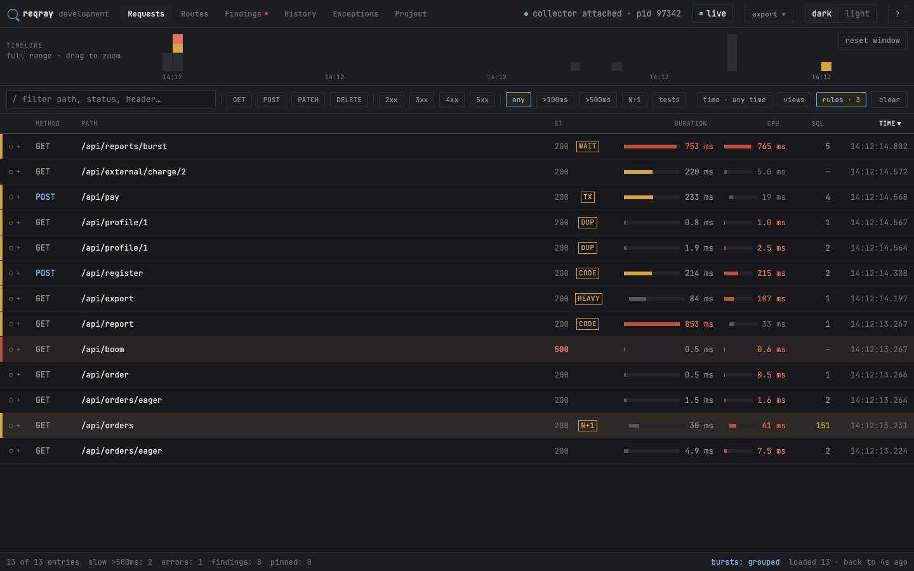

# @reqray/dashboard

The web panel of Reqray, built as static files. There is nothing to import: the
adapters and the collector depend on this package and serve it at `/_reqray/`.

Part of [Reqray](https://github.com/reqray/reqray) — a dev panel and request inspector for Node.js. It
instruments HTTP, SQL, outgoing calls and cache on its own, shows every
request as a waterfall, and finds N+1 down to the file and the line.

You get it by installing an adapter —
[`@reqray/fastify`](https://www.npmjs.com/package/@reqray/fastify),
[`@reqray/express`](https://www.npmjs.com/package/@reqray/express),
[`@reqray/nestjs`](https://www.npmjs.com/package/@reqray/nestjs) — or
[`@reqray/register`](https://www.npmjs.com/package/@reqray/register) alone.

What is in it: a live request list with filters and a timeline; a waterfall or
flamegraph per request; findings with the line of code and the suggested fix;
SQL with EXPLAIN; bodies, headers and logs after masking; replay with a
before/after comparison; per-route statistics; history; exceptions grouped by
stack. Dark and light themes, and a keyboard layer (`j`/`k`, `/`, `?`).

It is a React single-page application with no server-side rendering, and it
asks nothing of another origin: scripts, styles and the typeface (JetBrains
Mono, under the SIL Open Font License) are all served from the package.

## More

Everything else — the detectors, security defaults, measured overhead and a
demo that runs with one command — is in the
[main README](https://github.com/reqray/reqray#readme).

## License

[MIT](https://github.com/reqray/reqray/blob/main/LICENSE)
