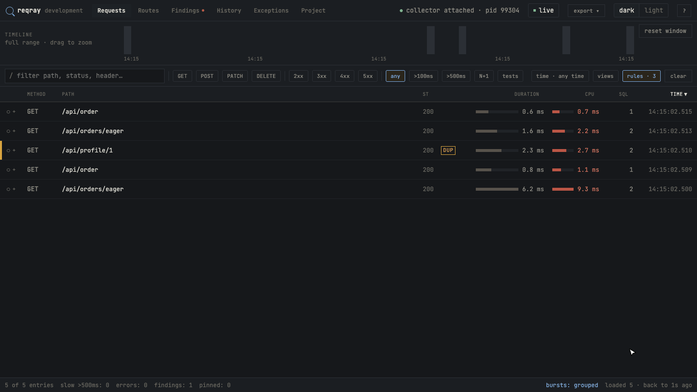

# @reqray/nestjs

Reqray for NestJS: every request as a waterfall — SQL, outgoing HTTP, cache,
bodies after masking — and N+1 queries pointed at the file and the line.



## Use

```bash
npm install @reqray/nestjs @reqray/register
```

```ts
import { Module } from '@nestjs/common';
import { ReqrayModule } from '@reqray/nestjs';

@Module({
  imports: [ReqrayModule.forRoot()],
})
export class AppModule {}
```

```bash
node --import @reqray/register dist/main.js
# open http://localhost:3000/_reqray/
```

One module in `imports`, nothing else. The platform — Express or Fastify — is
detected on its own. Exceptions are observed, not handled: your own exception
filters keep deciding the response, and Reqray records what was thrown.

`--import @reqray/register` is what instruments the database driver, the cache
client and `fetch`.

NestJS 10 and 11. Node 20 or newer.

## Options

`forRoot` takes the same options as the other adapters:

```ts
ReqrayModule.forRoot({
  panel: { gate: ({ headers }) => headers['x-admin'] === process.env.ADMIN_KEY },
  redact: { headers: ['x-api-key'] },
})
```

| Option | Default | What it does |
|---|---|---|
| `enabled` | `NODE_ENV !== 'production'` | Off means off: nothing is recorded and nothing is mounted |
| `mode` | from `NODE_ENV` | `'development'` keeps every request; `'production'` samples |
| `panel` | `{ path: '/_reqray' }` | `false` to not mount it; `{ gate }` decides who gets in |
| `transport` | memory, last 500 requests | Where records go — see `@reqray/store-sqlite`, `@reqray/transport-http`, `@reqray/transport-file` |
| `redact` | see below | `{ headers: [...], body: [...] }` extend the masked names |
| `detect` | all on | `{ nPlusOne: { threshold: 10 }, slowBudget: false }` |
| `sampling` | 100% locally, 1% in production | `{ rate, slowMs, alwaysOnError, alwaysOnFinding }` |
| `replay`, `explain`, `blame` | local development only | Opt-in anywhere else |
| `collectSqlValues` | `false` | SQL parameter values are never recorded unless you ask |

Masked before anything is stored: `authorization`, `cookie`, `set-cookie` in
headers; `password`, `token`, `secret`, `cardNumber`, `cvv`, `apiKey`,
`signature` in bodies and query strings.

Outside local development the panel does not mount without an explicit gate —
the application fails at startup with an explanation rather than opening
access. `panel: { gate: 'open' }` if open is what you mean, or a function:
`gate: ({ headers, ip }) => headers['x-admin'] === process.env.ADMIN_KEY`.

## More

Everything else — the detectors, security defaults, measured overhead and a
demo that runs with one command — is in the
[main README](https://github.com/reqray/reqray#readme).

## License

[MIT](https://github.com/reqray/reqray/blob/main/LICENSE)
