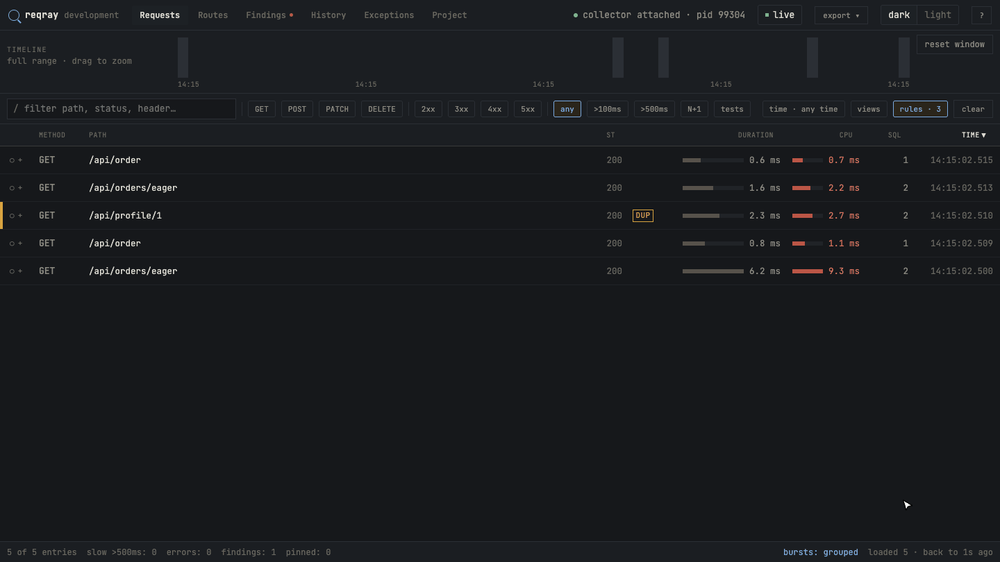

# @reqray/register

One flag on the command line, and a Node.js application's requests show up in
a panel as waterfalls — SQL, outgoing HTTP, cache — with N+1 queries pointed at
the file and the line. No code changes.



## Use

```bash
npm install -D @reqray/register
node --import @reqray/register app.js
```

```
reqray  instrumentation active
  ✔ pg@8.23.0            SQL
  ✔ ioredis@5.11.1       cache
  ✔ undici (built-in)    outgoing HTTP
reqray: no adapter found — panel is up at http://127.0.0.1:4310/_reqray/
```

Works for ESM and CommonJS applications. A CommonJS application can also be
started with `node --require @reqray/register app.js`.

## What it does

It installs loader hooks before your application loads its drivers, and
instruments them as they are imported:

| | Supported | Recorded |
|---|---|---|
| `pg` (and Prisma 7, which goes through it) | 8.x | the statement, its duration, the line that issued it — never parameter values |
| `ioredis` | 5.x | the command, the key, hit or miss — never values |
| undici and the built-in `fetch` | any | method, URL with secrets masked, status, duration |
| incoming `node:http` | any | used only when no adapter is present |

A driver outside its supported range is not patched; the startup report says
so and names the range.

## With an adapter

Without an adapter the panel runs on a port of its own and records what
`node:http` can see. Request bodies, route names and replay need the framework's
cooperation — add [`@reqray/fastify`](https://www.npmjs.com/package/@reqray/fastify),
[`@reqray/express`](https://www.npmjs.com/package/@reqray/express) or
[`@reqray/nestjs`](https://www.npmjs.com/package/@reqray/nestjs), and the panel
moves into the application at `/_reqray/`.

## Settings

| Variable | Default | |
|---|---|---|
| `REQRAY_PANEL_PORT` | `4310` | Port of the standalone panel |
| `REQRAY_STANDALONE` | on | `off` — instrument drivers, but start no panel of its own |

## Limits

- The flag has to be there. Hooks installed after a driver has loaded cannot
  reach it, and the startup report tells you when that happened.
- Bundled applications (esbuild, webpack, tsup) resolve imports at build time,
  so loader hooks never fire. Apply an instrumentation by hand instead:
  `instrumentPg().apply(pg)` from `@reqray/instrumentation-pg`.

## More

Everything else — the detectors, security defaults, measured overhead and a
demo that runs with one command — is in the
[main README](https://github.com/reqray/reqray#readme).

## License

[MIT](https://github.com/reqray/reqray/blob/main/LICENSE)
